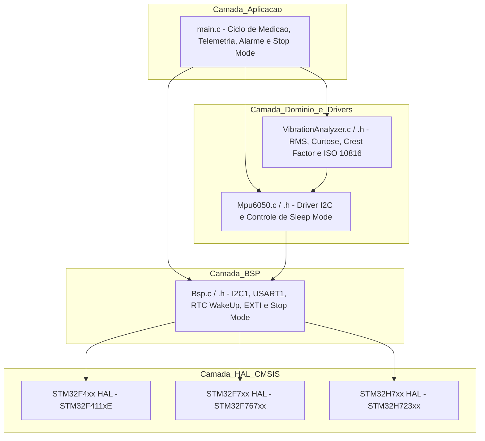
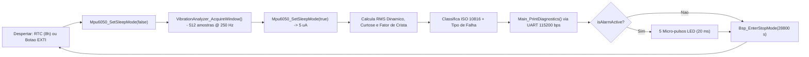
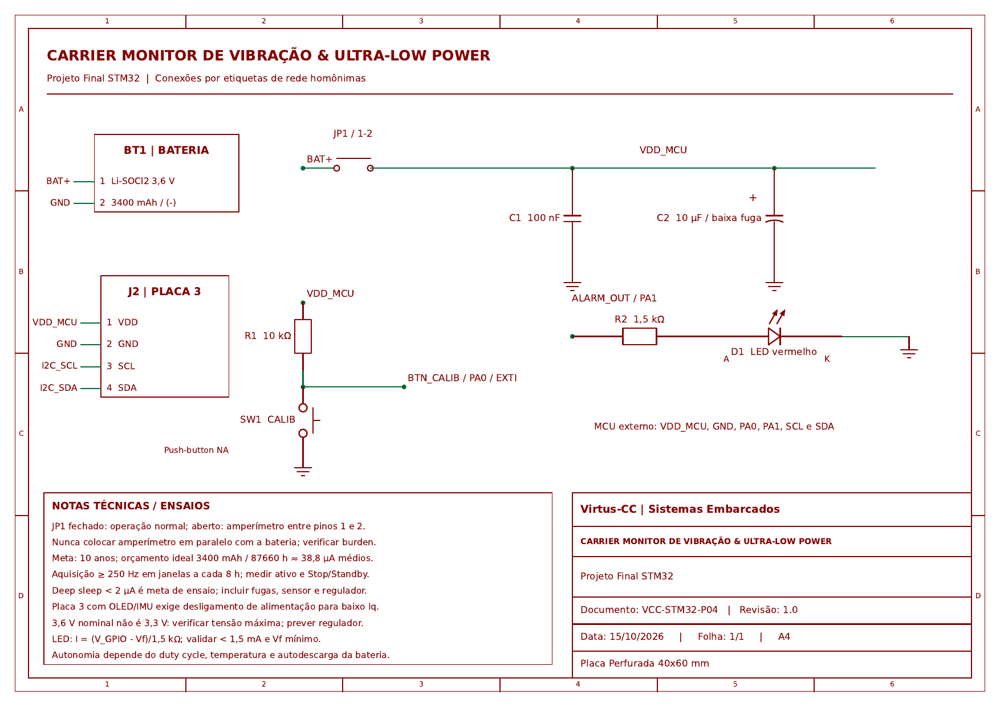

# Monitor de Vibração Industrial de Baixo Consumo (Autonomia > 10 Anos) em STM32


-brightgreen)


**Formação em Sistemas Embarcados Virtus-CC — Curso 2: Introdução aos Microcontroladores de 32 bits (Bare-Metal)**  
**Prof. D.Sc. Rafael Bezerra Correia Lima**

> [!NOTE]
> **Padrão de Engenharia de Firmware:** A arquitetura modular em camadas, a nomenclatura tipada de identificadores (`AssertTypes.h`), o encapsulamento via structs locais (`mainApp`), o isolamento via *Board Support Package* (`Bsp`) e a documentação Doxygen seguem as diretrizes do **Laboratório ASSERT (IFPB)**.

---

## Sumário

1. [Visão Geral do Projeto](#1-visão-geral-do-projeto)
2. [Branches e Suporte Multi-Placa (F411, F767, H723)](#2-branches-e-suporte-multi-placa-f411-f767-h723)
3. [Arquitetura de Software e Diagramas do Sistema](#3-arquitetura-de-software-e-diagramas-do-sistema)
4. [Processamento Estatístico e Classificação ISO 10816](#4-processamento-estatístico-e-classificação-iso-10816)
5. [Prova Matemática de Autonomia (> 10 Anos)](#5-prova-matemática-de-autonomia--10-anos)
6. [Hardware e Pinagem de Conexão](#6-hardware-e-pinagem-de-conexão)
7. [Estrutura do Repositório](#7-estrutura-do-repositório)
8. [Como Rodar: Configuração, Compilação e Gravação](#8-como-rodar-configuração-compilação-e-gravação)
9. [Roteiro de Validação Física em Shaker de Bancada](#9-roteiro-de-validação-física-em-shaker-de-bancada)

---

## 1. Visão Geral do Projeto

Este projeto implementa um **nó sensor autônomo para manutenção preditiva industrial** projetado para instalação em mancais de motores e redutores elétricos. O sistema avalia a severidade de vibração mecânica conforme a norma **ISO 10816**, combinando **RMS dinâmico**, **Curtose (*Kurtosis*)** e **Fator de Crista (*Crest Factor*)** com gerenciamento agressivo de energia para atingir autonomia superior a **10 anos** com uma única bateria $\text{Li-SOCl}_2$.

### Principais Diferenciais Técnicos
- **Aquisição em Surto (*Burst*) com Baixo Consumo:** O acelerômetro **MPU-6050** desperta do *Sleep Mode* ($5\,\mu\text{A}$) apenas durante a captura de **512 amostras a `250 Hz`** ($\approx 2{,}05\text{ s}$) com filtro passa-baixa digital (DLPF `44 Hz`), retornando imediatamente ao modo de repouso.
- **Stop Mode + RTC WakeUp + EXTI sob Demanda:** O STM32 permanece em **Stop Mode** ($< 5\,\mu\text{A}$) entre medições, despertando periodicamente a cada **8 horas** (`dBSP_RTC_WAKEUP_INTERVAL_SEC = 28800`) via RTC interno ou instantaneamente pelo botão de inspeção (`EXTI`).
- **Diagnóstico Preditivo Avançado (Requisitos Avançados):**
  - **Curtose (4º Momento Estatístico):** Detecta impactos transitórios em pistas e esferas de rolamentos ($\text{Kurtosis} > 4{,}5$) semanas antes da elevação do RMS global.
  - **Fator de Crista (*Crest Factor*):** Razão $\text{Pico}/\text{RMS} > 3{,}5$ para identificação de desgaste localizado.
  - **Classificação Dual (`eDiagnosisType_t`):** Distingue `eDIAG_NORMAL`, `eDIAG_BEARING_FAULT` (falha incipiente de rolamento) e `eDIAG_UNBALANCE_SEVERITY` (desbalanceamento severo).
- **Alarme Visual de Baixo Dreno:** Em condição de alarme (`rmsTotal > 0.45 g`), emite 5 micro-pulsos de `20 ms` limitados por resistor de $1{,}5\text{ k}\Omega$ ($\approx 1{,}3\text{ mA}$ por pulso).
- **Portabilidade Multi-Arquitetura (Cortex-M4 e Cortex-M7):** Código-fonte unificado compatível com **STM32F411CEU6**, **NUCLEO-F767ZI** e **STM32H723VGT6** via camada `Bsp`.

---

## 2. Branches e Suporte Multi-Placa (F411, F767, H723)

O repositório mantém **3 branches dedicadas por placa** (além da `main`), compartilhando a mesma base de código e selecionando as definições de hardware via diretivas de pré-processador em `Core/Inc/Bsp.h` (`STM32F411xE`, `STM32F767xx`, `STM32H723xx`):

| Branch Git | Placa / Alvo | MCU / Arquitetura | Símbolo de Compilação | LED Alarme | Botão EXTI |
| :--- | :--- | :--- | :---: | :---: | :---: |
| `board/stm32f411ceu6` | **Black Pill V2.0** | `STM32F411CEU6` (Cortex-M4F) | `STM32F411xE` | `PC13` | `PA0` |
| `board/nucleo-f767zi` | **NUCLEO-F767ZI** | `STM32F767ZIT6` (Cortex-M7F) | `STM32F767xx` | `PB0` | `PC13` |
| `board/stm32h723vgt6` | **DevEBox / H723** | `STM32H723VGT6` (Cortex-M7F) | `STM32H723xx` | `PC13` | `PA0` |
| `main` | **Branch Principal** | Multi-Target (Default `F411`) | Configurável no IDE | Configurável | Configurável |

### Alternando entre as Branches de Placa

```sh
# Para trabalhar/gravar na Black Pill (STM32F411CEU6)
git checkout board/stm32f411ceu6

# Para trabalhar/gravar na NUCLEO-F767ZI
git checkout board/nucleo-f767zi

# Para trabalhar/gravar na STM32H723VGT6
git checkout board/stm32h723vgt6
```

---

## 3. Arquitetura de Software e Diagramas do Sistema

### 3.1. Arquitetura em Camadas (Hardware Abstraction)



### 3.2. Pipeline de Aquisição, Diagnóstico e Ultra-Baixo Consumo



---

## 4. Processamento Estatístico e Classificação ISO 10816

### 4.1. Métricas Calculadas em Janela de 512 Amostras (`dVIB_WINDOW_SAMPLES`)

- **Remoção de Offset DC (Gravidade $1\text{ g}$) e RMS Triaxial:**

$$
\mu_x = \frac{1}{N} \sum_{i=1}^{N} A_x[i], \qquad \text{RMS}_x = \sqrt{\frac{1}{N} \sum_{i=1}^{N} (A_x[i] - \mu_x)^2}
$$

$$
\text{RMS}_{\text{total}} = \sqrt{\text{RMS}_x^2 + \text{RMS}_y^2 + \text{RMS}_z^2}
$$

- **Curtose (*Kurtosis*) e Fator de Crista (*Crest Factor*):**

$$
\text{Kurtosis} = \frac{\frac{1}{N} \sum_{i=1}^{N} (x_i - \mu)^4}{\sigma^4}, \qquad \text{CF} = \frac{\text{Pico}}{\text{RMS}}
$$

### 4.2. Tabela de Severidade ISO 10816 e Diagnóstico

| Faixa de Vibração ($\text{RMS}_{\text{total}}$) | Classificação ISO | Diagnóstico / Ação Operacional |
| :--- | :--- | :--- |
| **$< 0{,}20\text{ g}$** | **Classe A / B (`eVIB_SEVERITY_GOOD`)** | Máquina em operação normal |
| **$0{,}20\text{ g} - 0{,}45\text{ g}$** | **Classe C (`eVIB_SEVERITY_ACCEPTABLE`)** | Operação aceitável; requer inspeção de rotina |
| **$> 0{,}45\text{ g}$** | **Classe D (`eVIB_SEVERITY_ALARM`)** | Vibração destrutiva; aciona 5 pulsos de alarme |
| $\text{Kurtosis} > 4{,}5$ ou $\text{CF} > 3{,}5$ | **Falha Incipiente (`eDIAG_BEARING_FAULT`)** | Impactos repetitivos / desgaste em rolamento |
| $\text{RMS} > 0{,}45\text{ g}$ e $\text{Kurtosis} \le 3{,}5$ | **Desbalanceamento (`eDIAG_UNBALANCE_SEVERITY`)** | Desbalanceamento mecânico severo |

---

## 5. Prova Matemática de Autonomia (> 10 Anos)

### Perfil de Operação por Ciclo de 8 Horas ($T_{\text{periodo}} = 28.800\text{ s}$)
1. **Fase Ativa ($T_{\text{ativo}} \approx 2{,}1\text{ s}$):**
   - MCU ativo processando: $15{,}0\text{ mA}$
   - MPU-6050 medindo: $3{,}5\text{ mA}$
   - Telemetria UART: $1{,}0\text{ mA}$
   - $I_{\text{ativo}} = 19{,}5\text{ mA}$
2. **Fase de Repouso ($T_{\text{sleep}} = 28.797{,}9\text{ s}$):**
   - MCU em Stop Mode com RTC ativo: $4{,}5\,\mu\text{A}$
   - MPU-6050 em modo Sleep: $5{,}0\,\mu\text{A}$
   - Correntes de fuga em barramentos e PCB: $2{,}5\,\mu\text{A}$
   - $I_{\text{sleep}} = 12{,}0\,\mu\text{A} = 0{,}012\text{ mA}$

### Corrente Média Efetiva e Vida Útil ($\text{Li-SOCl}_2$, $2.400\text{ mAh}$)

$$
I_{\text{medio}} = \frac{(19{,}5\text{ mA} \times 2{,}1\text{ s}) + (0{,}012\text{ mA} \times 28.797{,}9\text{ s})}{28.800\text{ s}} \approx \mathbf{13{,}4\,\mu\text{A}}
$$

- Capacidade útil com fator de *derating* de $85\%$: $C_{\text{util}} = 2.040\text{ mAh}$.
- Consumo anual total (firmware $117{,}4\text{ mAh/ano}$ + autodescarga $24\text{ mAh/ano}$): $141{,}4\text{ mAh/ano}$.

$$
\text{Autonomia} = \frac{2.040\text{ mAh}}{141{,}4\text{ mAh/ano}} \approx \mathbf{14{,}4\text{ Anos}} \quad (> 10\text{ anos})
$$

---

## 6. Hardware e Pinagem de Conexão

| Elemento do Circuito | Black Pill (`F411`) | `STM32H723` | `NUCLEO-F767ZI` | Função / Observação |
| :--- | :---: | :---: | :---: | :--- |
| **MPU-6050 SCL** | `PB6` | `PB6` | `PB6` | `I2C1_SCL` (Clock com pull-up de $4{,}7\text{ k}\Omega$) |
| **MPU-6050 SDA** | `PB7` | `PB7` | `PB7` | `I2C1_SDA` (Dados com pull-up de $4{,}7\text{ k}\Omega$) |
| **MPU-6050 AD0** | `GND` | `GND` | `GND` | Endereço I²C `0x68` |
| **MPU-6050 VCC / GND** | `3.3V / GND` | `3.3V / GND` | `3.3V / GND` | Alimentação do sensor |
| **LED Alarme** | `PC13` | `PC13` | `PB0` | Alerta visual (resistor limitador de $1{,}5\text{ k}\Omega$) |
| **Botão de Teste (EXTI)** | `PA0` | `PA0` | `PC13` | Despertar manual sob demanda |
| **UART Telemetria** | `PA9` (TX) | `PA9` (TX) | `PD8` (ST-Link VCP) | Diagnóstico serial a `115200 bps` |

### Diagrama Esquemático do Circuito


> Versão vetorial para impressão/inspeção: [Docs/Esquematico_Placa4_Projeto_Final_Monitor_Vibracao.pdf](Docs/Esquematico_Placa4_Projeto_Final_Monitor_Vibracao.pdf)

---

## 7. Estrutura do Repositório

```text
projeto-final-vibracao/
├── Core/
│   ├── Inc/
│   │   ├── AssertTypes.h             # Tipos padronizados de largura fixa (u8, u16, u32, bool)
│   │   ├── Bsp.h                     # Interface BSP (I2C1, UART, RTC WakeUp, EXTI e Stop Mode)
│   │   ├── Mpu6050.h                 # Registradores MPU-6050 e controle de Sleep Mode
│   │   ├── VibrationAnalyzer.h       # API de analise RMS, Curtose, CF e enums ISO 10816
│   │   ├── main.h                    # Header principal da aplicacao
│   │   ├── stm32f4xx_hal_conf.h      # Configuracao HAL para STM32F4
│   │   └── stm32h7xx_hal_conf.h      # Configuracao HAL para STM32H7
│   └── Src/
│       ├── Bsp.c                     # Inicializacao de periféricos, RTC e entrada/saida Stop Mode
│       ├── Mpu6050.c                 # Leitura burst I2C e gerenciamento de energia do sensor
│       ├── VibrationAnalyzer.c       # Calculo de RMS dinamico, Curtose, CF e diagnostico
│       └── main.c                    # Ciclo de medicao, telemetria UART, alarme e Stop Mode
├── Docs/
│   ├── esquematico_circuito.png      # Esquematico do monitor de vibracao
│   └── Esquematico_Placa4_Projeto_Final_Monitor_Vibracao.pdf
├── projeto-final-vibracao.ioc        # Projeto STM32CubeMX
└── README.md
```

---

## 8. Como Rodar: Configuração, Compilação e Gravação

### 8.1. Pré-requisitos
- **STM32CubeIDE** (ou toolchain `arm-none-eabi-gcc` + drivers CMSIS/HAL da família alvo).
- Módulo **MPU-6050** conectado em `PB6`/`PB7` (`I2C1`), conversor USB-Serial (ou ST-Link VCP) e gravador **ST-Link**.

### 8.2. Compilação e Gravação
1. Importe o projeto no **STM32CubeIDE** (ou utilize `projeto-final-vibracao.ioc` para gerar a base HAL da placa selecionada).
2. *(Opcional para testes rápidos em bancada)*: Em `Core/Inc/Bsp.h`, ajuste `dBSP_RTC_WAKEUP_INTERVAL_SEC` de `28800` (8 horas) para `10` ou `30` segundos.
3. Compile para o alvo correspondente (`STM32F411xE`, `STM32F767xx` ou `STM32H723xx`), grave via ST-Link e abra o terminal serial em **`115200 bps`, 8-N-1**.

---

## 9. Roteiro de Validação Física em Shaker de Bancada

1. **Preparação:** Conecte o terminal serial a `115200 bps` (8-N-1) e fixe o módulo firmemente à mesa vibratória (*shaker* de calibração).
2. **Teste em Repouso:** Acione o botão de despertar (`BTN_USER`). O terminal deve registrar $\text{RMS}_{\text{total}} \le 0{,}05\text{ g}$ e classificação normal (`BOM`).
3. **Teste Dinâmico em `30 Hz`:** Ajuste o *shaker* para aceleração controlada de $0{,}30\text{ g}$ e acione `BTN_USER`. O sistema reportará severidade `ACEITAVEL` (`eVIB_SEVERITY_ACCEPTABLE`).
4. **Teste de Alarme em `60 Hz`:** Eleve a excitação do *shaker* para $0{,}60\text{ g}$. O firmware detecta $\text{RMS}_{\text{total}} > 0{,}45\text{ g}$, reporta alarme crítico, emite os 5 pulsos no LED e retorna ao **Stop Mode**.
